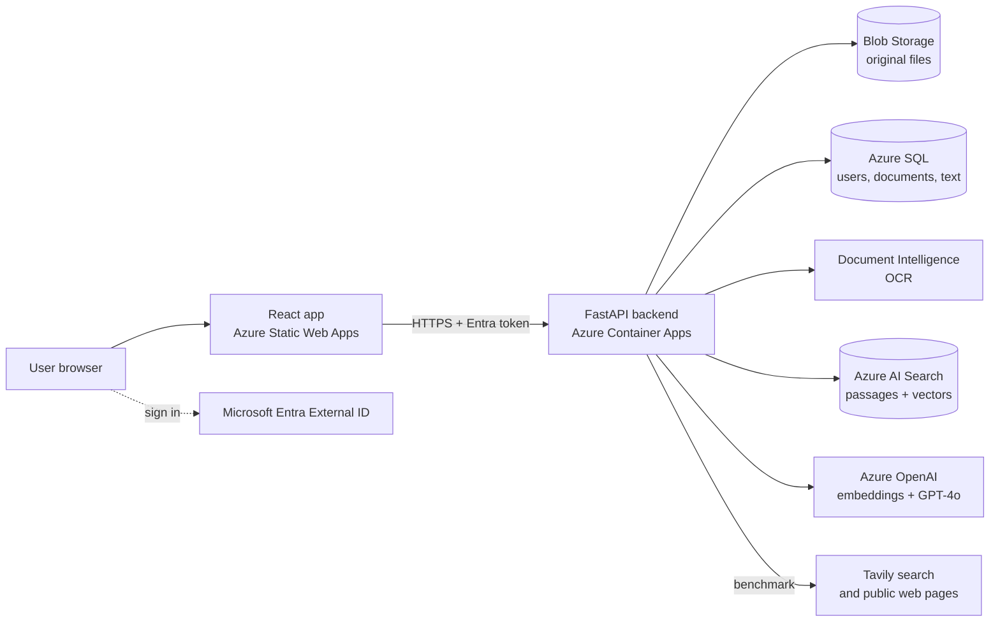

# DocMind

**Cloud-native semantic document search with cited answers.** Upload your documents, ask questions in English or Arabic, and get answers that point to the exact page they came from. When the documents don't contain the answer, DocMind says so instead of guessing.

**Live demo:** https://happy-sand-029f66910.4.azurestaticapps.net

Senior Project (SE499), Software Engineering. Built by Faisal Alrabiah and Majed Barri. Supervisor: Dr. Skander Turki.

## What it does

- Upload PDFs, Word files and scans. Text is read page by page, and scanned pages go through OCR.
- Search by meaning as well as by keyword.
- Ask a question and get an answer written only from your documents, with numbered citations to source pages.
- Every citation is checked by the backend. If no valid citation supports an answer, the reply is "not found".
- Each user signs in and gets a private workspace. Another user's documents return 404.
- Works with Arabic text, stored as Unicode end to end.
- **Benchmark:** compare one of your documents with similar documents from other organisations. DocMind suggests pages found on the web, you choose which to compare against, and it returns a gap table: what is covered, partly covered or missing, with suggested wording for each gap. Every "covered" verdict cites a passage of your document.

## Architecture



**Roles of each store.** Blob Storage keeps the original files. Azure SQL is the source of truth for users, workspaces, documents and extracted text. Azure AI Search holds a rebuildable index of passages and vectors.

## How a question is answered (RAG)

1. **Index (on upload):** pages are split into 900-character passages with a 100-character overlap that never crosses a page. Each passage is embedded (1024 dimensions) and indexed.
2. **Retrieve:** the question is embedded, and keyword and vector rankings are merged with reciprocal rank fusion, filtered to the caller's workspace.
3. **Answer:** GPT-4o writes only from the numbered passages and cites each claim.
4. **Verify:** the backend checks every citation. No valid citation means "not found".

## How benchmarking works

1. **Find:** the model describes your document and writes search queries. Tavily web search returns candidate pages, which you review and choose (up to four), or you add an address yourself.
2. **Read:** each chosen page or PDF is downloaded and turned into text. The download is restricted because the address comes from a user: only http/https on the standard ports, no private or internal network addresses (the connection goes to the address that was checked), every redirect re-checked, and limits on size and time.
3. **Compare:** the model lists what each source provides and merges the lists into one checklist. For every item DocMind retrieves the best matching passages from your document and the model judges them.
4. **Verify:** a covered or partly covered verdict is kept only if it cites a real passage that was retrieved for that item; otherwise it is shown as missing.

Limits: sites that block automated access or need scripts or a login cannot be read (the screen says why, and you can pick another page). The result is guidance, not a verdict: check each suggestion against the source.

## Tech stack

| Area | Technology |
| --- | --- |
| Frontend | React, TypeScript, Vite, MSAL |
| Backend | Python, FastAPI, SQLAlchemy |
| Hosting | Azure Container Apps (API), Azure Static Web Apps (web app), Azure Container Registry |
| Data | Azure Blob Storage, Azure SQL, Azure AI Search |
| AI | Azure OpenAI (GPT-4o, embeddings), Azure AI Document Intelligence |
| Web search | Tavily (free plan), key stored as a Container Apps secret |
| Identity | Microsoft Entra External ID |
| Infrastructure as code | Terraform |
| CI/CD | GitHub Actions with passwordless Azure sign-in (OIDC) |
| Monitoring | Azure Monitor: Log Analytics, metric alerts, budget alerts |

## Evaluation

31 questions with known answers over four test documents (three English, one Arabic).

| | Default search | Scoped to one document |
| --- | --- | --- |
| Answerable questions correct | 24 / 27 (89%) | 26 / 27 (96%) |
| Unanswerable questions answered "not found" | 4 / 4 | 4 / 4 |
| Citations pointing to the right document | 100% | 100% |

Findings: single-fact and Arabic questions work reliably, list questions need the document scope, and counting items across a table is still unreliable. The question set, run script and results are in [`evaluation/`](evaluation/).

## Run it locally

You need Python 3.13, Node.js, and Azure resources for search, storage, OpenAI and OCR (the infrastructure is in `infra/`).

```bash
# Backend (sign-in switched off for local work)
cd backend
python -m venv .venv
# Windows: .venv\Scripts\Activate.ps1      macOS/Linux: source .venv/bin/activate
pip install -r requirements.txt
export AUTH_BACKEND=none                     # PowerShell: $env:AUTH_BACKEND = "none"
uvicorn app.main:app --reload

# Frontend (in a second terminal)
cd frontend
npm install
npm run dev
```

Benchmarking uses a local stand-in (made-up search results, no language model) unless `WEB_SEARCH_BACKEND=tavily` and `TAVILY_API_KEY` are set. In the cloud the key comes from the `tavily_api_key` Terraform variable, kept in the git-ignored `terraform.tfvars`.

Backend settings are read in `backend/app/config.py`, and the frontend variables are listed in `frontend/.env.example`.

Run the tests:

```bash
cd backend && pytest
cd frontend && npm test
```

## Run the evaluation

With the backend running locally and the four test documents uploaded:

```bash
cd evaluation
python run_eval.py            # default search
python run_eval.py --scoped   # each question limited to its own document
```

## Deployment

Everything is defined in Terraform under `infra/environments/dev`. On every push to `main`, GitHub Actions validates the Terraform, runs the backend and frontend tests, builds the container image (checking that the SQL driver loads), and deploys the API and the web app.

## Repository layout

```
backend/      FastAPI app, tests, Dockerfile
frontend/     React app
infra/        Terraform modules and environments
evaluation/   Question set, run script, results
.github/      CI/CD workflow
```

## License

Academic project, Senior Capstone.
